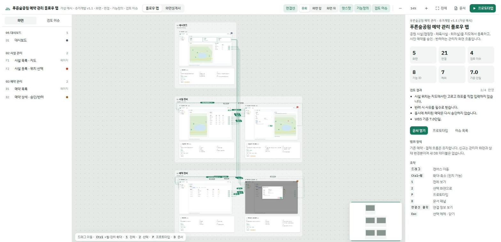
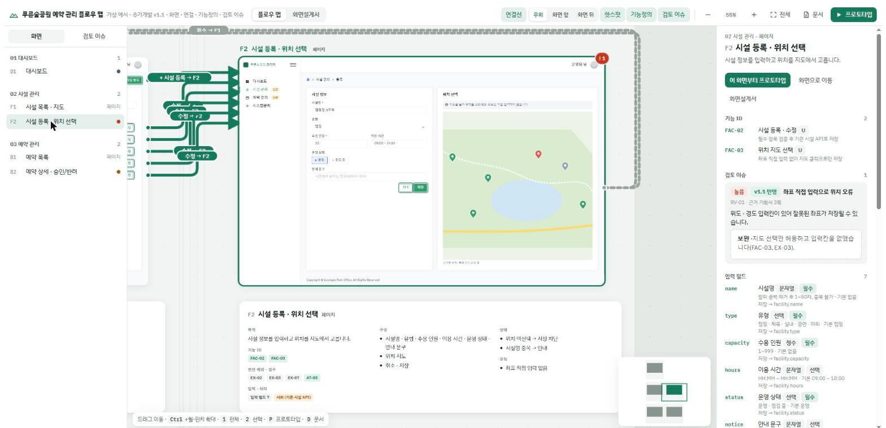
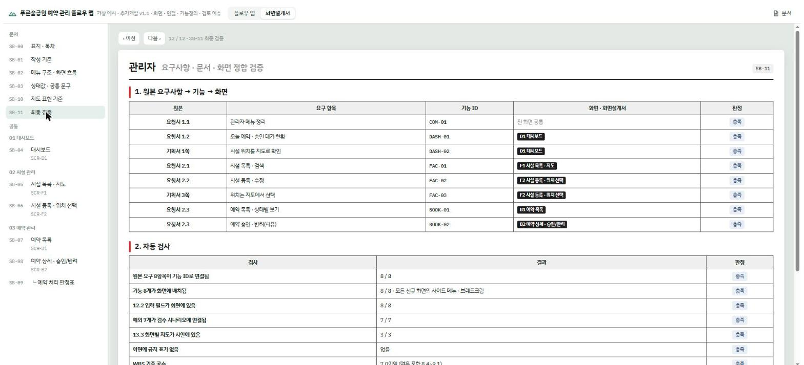
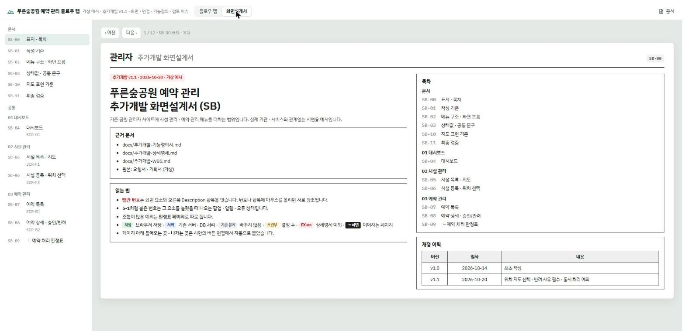
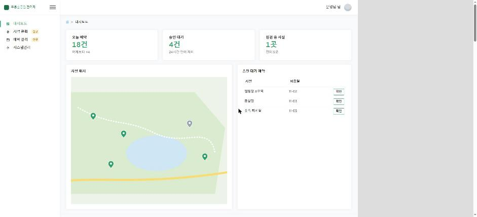

<div align="center">


# screen-spec-kit

**기획서 한 벌이 화면설계서 · 플로우 맵 · 디자인 캔버스 · 검수표가 되는 Claude Code 플러그인**

요청서 · 기획서 · 참고 화면설계서 · 배포 사이트를 읽고<br>
개발 문서 → 화면 시안 → 플로우 맵 → 화면설계서(SB) → Claude Design 보드 → 자동 검수까지 한 번에 만듭니다.

[](CHANGELOG.md)
[](https://code.claude.com/docs/en/plugins)
[](LICENSE)
[](https://github.com/donghk-cloud/screen-spec-kit/actions/workflows/validate.yml)
[](https://github.com/donghk-cloud/screen-spec-kit/stargazers)



<sub>가상 예시 <code>examples/demo-park</code>(도시공원 시설 예약 관리)로 만든 플로우 맵. 화면 5 · 연결 21 · 기능 8 · 예외 7.</sub>

</div>

---

## 왜 만들었나

관리자 시스템 추가 개발을 하면 같은 내용을 네 번 씁니다. 기능정의서에 한 번, 화면설계서(SB)에 한 번, 디자인 툴에 한 번, 검수표에 한 번. 그리고 넷이 조금씩 어긋납니다. 기능 ID가 SB에 없고, 예외 문구가 디자인과 다르고, 검수 시나리오에 빠진 예외가 생깁니다.

screen-spec-kit은 **원본은 Markdown 문서 3종 + 화면 시안 한 파일**로 두고 나머지를 전부 거기서 생성합니다. 그리고 생성물끼리 맞는지 스스로 검사합니다.

## 무엇이 다른가

- 🧭 **한 원본 → 네 가지 산출물** — 기능정의서 · 상세명세 · WBS(Markdown)와 `project.js`(화면 시안)를 넣으면 플로우 맵, 화면설계서, 문서 패널, Claude Design 보드가 같은 데이터로 나옵니다. 어긋날 곳이 없습니다.
- 🔴 **SB 번호 마커 자동 배치** — `mk('2', '수용 인원', …)`처럼 *글자*나 선택자로 요소를 가리키면 빨간 번호 원과 박스가 그 위치에 붙고, 원끼리 · 글자와 겹치지 않는 자리를 엔진이 고릅니다. 화면이 바뀌어도 좌표를 다시 찍을 필요가 없습니다.
- 🔀 **화면을 피해 가는 연결선** — 버튼의 `data-go="F2"`에서 연결선을 자동으로 뽑아 **우회 / 화면 앞 / 화면 뒤** 세 모드로 그립니다. 연결선을 누르면 출발 · 누르는 곳 · 도착 · 넘기는 값 · 도착 화면 기능 ID가 나옵니다.
- 📋 **국내 관리자 SB 문법** — 머리줄(관리자 · 화면 경로) → 화면(빨간 번호) → Description(구성 · 입력 규칙 · `[예외]` 문구 · 저장 위치) → 하위 상태 견본(2-1, 5-1) → 판정표. 공공 · SI 프로젝트에서 바로 쓰는 형식입니다.
- ✅ **요구사항 추적 최종 검증** — 원본 요구 → 기능 ID → 화면, 12.2 입력 필드 → 시안 라벨, 예외 → 검수 시나리오, 지도 명세 → 시안, 금지 표기, WBS 합계를 표로 판정합니다. 하나라도 빠지면 "확인 필요"로 뜹니다.
- 🗺️ **지도 화면 명세** — 지도 기본 설정 · 기호(카카오 객체 · 색 · 쌓임 순서) · 화면별 구성 · 그리기 규칙을 문서 13장에서 읽어 SB 지도 기준 페이지로 만듭니다.
- 🤖 **자동 검수** — 로컬 서버 + Claude in Chrome으로 SB 마커 잘림 · 겹침, 연결선의 화면 관통, 디자인 보드 잘림 · 빈 공간을 숫자로 보고합니다. "0건"이 될 때까지 고칩니다.
- 🎨 **Claude Design으로 내보내기** — 시안을 `.dc.html` 보드와 `canvas.json`으로 내보내고, 버튼 연결은 보드 간 링크가 됩니다.

## 화면

| 화면 선택 → 인스펙터 | 연결선 클릭 → 연결 정보 |
|---|---|
|  |  |
| **화면설계서(SB) 페이지** | **최종 검증** |
|  |  |
| **SB 표지 · 목차** | **Claude Design 보드 (내보내기)** |
|  |  |

## 흐름

```
원본(요청서 · 기획서 HWP/PPT/PDF · 참고 SB · 배포 사이트)
   │ source-intake      → 근거 노트 · 사이트에서 잰 디자인 값
   ▼
docs/  기능정의서 · 상세명세 · WBS        (spec-docs · check_docs.py)
   ▼
spec-kit/  theme.css · project.js(시안) · sb-pages.js(SB)
   │ build_kit.py       → flowmap.html  (플로우 맵 + 화면설계서 + 문서 패널 + 최종 검증)
   │ export_design.mjs  → design/project/*.dc.html · canvas.json
   ▼
artifact-qa (audits/*.js · harness.html) → 0건 → Artifact로 게시
```

## 설치

```bash
# Claude Code 안에서
/plugin marketplace add donghk-cloud/screen-spec-kit
/plugin install screen-spec-kit@screen-spec-kit
```

필요: Python 3.10+, Node 18+. 자동 검수에는 [Claude in Chrome](https://claude.com/chrome), 게시에는 Artifact 도구가 필요합니다.

## 빠른 시작

```text
/screen-spec-kit:new     <작업 폴더> <요청서.hwp> <기획서.pptx> https://<배포 사이트>
/screen-spec-kit:build   <작업 폴더>/spec-kit --design
/screen-spec-kit:audit   <작업 폴더>/spec-kit
/screen-spec-kit:publish <작업 폴더>/spec-kit
```

또는 그냥 이렇게 말하면 `screen-spec-kit` 스킬이 순서를 잡습니다.

> 이 기획서랑 운영 사이트 보고 화면설계서랑 플로우 맵 만들어줘

### 예시를 직접 빌드해 보기

```bash
git clone https://github.com/donghk-cloud/screen-spec-kit && cd screen-spec-kit
python scripts/check_docs.py --docs examples/demo-park/docs --screens D1,F1,F2,B1,B2
python scripts/build_kit.py examples/demo-park                 # → examples/demo-park/flowmap.html
node scripts/export_design.mjs examples/demo-park examples/demo-park/design-export
python -m http.server 8768 --bind 127.0.0.1                     # http://127.0.0.1:8768/examples/demo-park/flowmap.html
```

`file://`로 열면 일부 기능이 막히므로 로컬 서버로 엽니다.

## 구성

| 경로 | 내용 |
|---|---|
| `skills/screen-spec-kit` | 진입점: 전체 순서 · 원칙 · 자주 틀린 것 |
| `skills/source-intake` | 원본 파일(HWP · PPTX · PDF …) 읽기, 배포 사이트 메뉴 · 디자인 값 측정 |
| `skills/spec-docs` | 문서 3종 작성 · 대조, 빌드가 읽는 표 목록 |
| `skills/flowmap-artifact` | `project.js` 계약 · 시안 규칙 · 연결선 · 게시 |
| `skills/sb-screen-spec` | SB 문법(마커 · 토큰 · 하위 상태 · 판정표 · SBCONF) |
| `skills/design-canvas` | Claude Design 보드 내보내기 · 컴포넌트화 · 병합 |
| `skills/artifact-qa` | 로컬 서버 + Chrome 자동 검수, 결과 해석, 보고 형식 |
| `commands/` | `new` · `build` · `audit` · `publish` |
| `engine/` | 공통 엔진(template.html · sb-head.js · sb-tail.js · sb.css). 프로젝트마다 고치지 않습니다 |
| `scripts/` | `build_kit.py` · `build_flowmap.py`(문서 파서) · `check_docs.py` · `export_design.mjs` · `audits/` |
| `templates/project-starter/` | 새 프로젝트 틀(화면 3 · 문서 3종 뼈대) |
| `examples/demo-park/` | 끝까지 만든 가상 예시(화면 5 · SB 12쪽 · 기능 8 · 예외 7 · 검수 4) |

## 엔진 계약 (요약)

| 파일 | 정의할 것 |
|---|---|
| `project.js` | `PROJECT` · `SHARE` · `H`(화면 ID → 시안 HTML) · `SCREENS` · `FLOWS` · `ISSUES` |
| `sb-pages.js` | `SBCONF` + `pgDocs()` · `pg()` · `mk()` · `pgMap()` · `pgVerify()` |
| `theme.css` | `.scr` 아래 클래스. 이름은 유지하고 값만 배포 사이트에 맞춥니다 |
| `docs/*.md` | 표 머리행으로 읽습니다 → [`doc-tables.md`](skills/spec-docs/references/doc-tables.md) |

자세한 문법: [`project-contract.md`](skills/flowmap-artifact/references/project-contract.md) · [`mark-syntax.md`](skills/sb-screen-spec/references/mark-syntax.md)

## 원칙

- **기존 화면은 고치지 않고 확장을 문서화합니다.** 시안은 배포 사이트에서 잰 색 · 글꼴 · 간격으로 그립니다.
- **화면은 캡처가 아니라 HTML로 그립니다.** 그래서 마커 배치 · 라벨 대조 · 디자인 내보내기가 됩니다.
- **비밀번호 · 키는 다루지 않습니다.** 배포 사이트 로그인은 사용자가 직접 합니다.

## 버전

| 버전 | 내용 |
|---|---|
| 1.1.0 | 공개 버전. 문서 패널 문구를 `PROJECT.docs`로 분리, 기능 ID 접두어 제한 제거, 가상 예시 `demo-park` |
| 1.0.0 | 내부 버전. 엔진 · 프로젝트 분리, 스킬 7 · 명령 4 |

전체 내역은 [CHANGELOG.md](CHANGELOG.md).

## 기여

이슈와 PR 환영합니다. [CONTRIBUTING.md](CONTRIBUTING.md)를 먼저 읽어 주세요.

## 라이선스

[MIT](LICENSE) © donghk-cloud. 예시의 서비스 · 기관 · 인물은 모두 가상입니다.
